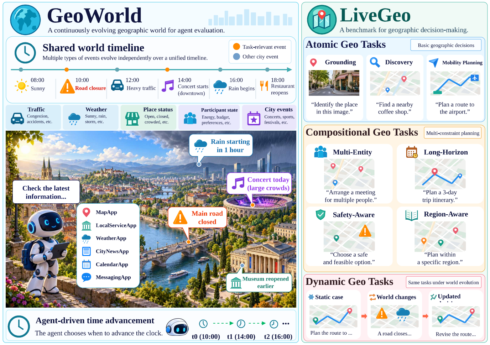

<div align="center">

# GeoWorld

**Build evolving city environments for geographic agents.**

English · [简体中文](README.zh-CN.md)

[](https://arxiv.org/abs/2611.17267)
[](https://livegeoworld.github.io/)
[](https://github.com/LiveGeoWorld/LiveGeo-benchmark)
[](#quick-start)

[**Quick Start**](#quick-start) · [**Documentation**](#documentation) · [**Citation**](#citation)

</div>



## Overview

**GeoWorld** is a geographic simulation platform. Build or load a real city, let agents query places, routes, and local services through tools, and observe how they respond as traffic, weather, opening hours, and city events change over a shared timeline.

**LiveGeo** is the benchmark we built with GeoWorld. It evaluates whether agents can make valid geographic decisions — and keep them valid as the world changes — across seven task categories, each run under matched static and dynamic settings.

| | |
| --- | --- |
| **World** | 6 real cities · 88 regions · 1,376 points of interest · 107,372 cached routes |
| **Agent interface** | 8 Apps · 31 tools, all answered against the world state at the current virtual time |
| **Benchmark** | 1,237 tasks: 1,088 static + 149 matched dynamic, across 7 categories |

**Where to start**

- [**Try GeoWorld**](#quick-start) — open the bundled sample city in World Studio. No API keys needed.
- [**Evaluate with LiveGeo**](#run-livegeo) — test your agent on the benchmark tasks.
- [**Build your own benchmark**](#build-your-own-benchmark) — write a task generator on top of GeoWorld's cities, tools, and event replay.

## Quick Start

With Python 3.10 or later, run from the repository root:

```bash
python -m pip install -e .
python -m vis.demo --port 8769
```

Then open <http://localhost:8769/> to explore the example map, view the character graph, or open the world manager.

- The bundled example contains three recorded London places with their cached routes and service records, plus three recorded participants.
- It needs **no API credentials**. The first launch installs the example world into `outputs/worlds/`; later launches reuse it without overwriting your changes. The browser loads basemap tiles online.
- **Tasks & Evaluation** includes recorded task examples for trying the workbench.

To build a city from geographic sources, configure your providers, create an empty world in World Studio, and choose a city or import a city seed. See the [world construction guide](docs/world_construction.md).

## Run LiveGeo

LiveGeo contains **1,088 static tasks and 149 matched dynamic tasks** across seven categories. The task data is released in [LiveGeo-benchmark](https://github.com/LiveGeoWorld/LiveGeo-benchmark).

| Level | Task | What the agent does |
| --- | --- | --- |
| Atomic | Grounding | Identify a place from visual or textual clues. |
| Atomic | Discovery | Find a place that meets location, service, or preference requirements. |
| Atomic | Mobility Planning | Decide whether a trip is feasible and give a route when required. |
| Compositional | Multi-Entity | Find a common plan for people with different starting points and schedules. |
| Compositional | Long-Horizon | Plan a sequence of activities that fit together across one or more days. |
| Compositional | Safety-Aware | Account for risks that affect a destination or the route to it. |
| Compositional | Region-Aware | Apply local practices and geographic context when choosing a place. |

Matched dynamic tasks start from the same request and initial world state as their static counterpart:

- **Static** — task-relevant conditions stay fixed.
- **Task-Only Dynamics** — the events authored for that task take effect as virtual time advances.
- **Shared Dynamics** — other city events share the same timeline, so the agent must work out which changes affect its plan.

Recorded model answers, Judge results, and tool calls can be browsed in **Tasks & Evaluation → Test Results**, with no model credentials. To run your own evaluations, see the [evaluation guide](docs/evaluation.md).

## Build Your Own Benchmark

You can write your own task generator on top of GeoWorld. Your generator decides which situations to create and what makes an answer valid; GeoWorld provides the city, the tools agents use to inspect it, and a clock for replaying changes.

1. **Pick a city.** Reuse a saved city snapshot or build one in World Studio. Record the version you generate from, so tasks always run against the same places, routes, and services.
2. **Generate requests and reference answers.** Use facts from that city to choose a scenario and write a user request. Save the requirements and the evidence behind the reference answer for evaluation. Give the agent the request and the tools it needs.
3. **Schedule changes.** For a dynamic task, specify when a change happens, what it affects, and where an agent can learn about it. Check that the reference answers satisfy the requirements before and after the change.
4. **Run and score.** Load the task with its city snapshot and event schedule, let the agent interact with the environment, and score its submission with your task's rules.

> **Example: café selection.** Find cafés that are open at the requested time and within the user's walking limit. Choose and verify a reference answer, then schedule a temporary closure and check which alternatives still work. Running the same request with and without that event shows whether an agent notices the change and switches to a viable alternative. The LiveGeo pipeline is a worked example of building and verifying this kind of matched pair.

## Data and Reproducibility

| Data | What it contains |
| --- | --- |
| **GeoWorld city snapshots** | Geographic and service data used by the simulator. The paper's instantiation covers 6 cities, 88 regions, 1,376 points of interest, and 107,372 cached route records. |
| **LiveGeo benchmark data** | Task requests, their city versions, scheduled events, and the reference material used for evaluation. |
| **World Studio example** | A small recorded map and character file for trying the interface locally. |

To reproduce a run, use the same code and dataset versions, city snapshot, evaluation setting, and agent and model configuration. The [data guide](data/README.md) explains where the example and local world outputs live.

## Repository Structure

```text
GeoWorld/
├── world_module/   City maps, characters, regional information, world versions
├── vis/            World Studio web interface and local server
├── task_module/    Task construction
├── app/            Agent-facing Apps and tools
├── test_runner/    Environment execution and evaluation
├── shared/         Shared configuration, provider clients, utilities
├── seeds/          City seeds
├── examples/       Recorded examples for World Studio, the workbench, and Test Results
└── docs/           Usage guides
```

## Tests

```bash
python -m pip install -e ".[test]"
python -m pytest -q
```

Unit tests use temporary data and the bundled configuration example. They need no API credentials and do not download the Wikivoyage source package.

## Documentation

| Guide | Topic |
| --- | --- |
| [World construction](docs/world_construction.md) | Provider configuration and city registration |
| [Evaluation](docs/evaluation.md) | Running evaluations and reading Test Results |
| [Grounding generation](docs/grounding.md) | Generating Grounding tasks |
| [Task review](docs/task_review.md) | Reviewing and editing tasks in the workbench |
| [Architecture](docs/architecture.md) | How the modules fit together |
| [Demo data](docs/demo_data.md) | What the bundled example contains |
| [Data organization](data/README.md) | Where example and local world outputs live |

## Citation

If you use GeoWorld or LiveGeo in your research, please cite:

```bibtex
@misc{zhou2026livegeobenchmarkinggeographicagents,
  title={LiveGeo: Benchmarking Geographic Agents in Continuously Evolving Worlds},
  author={Pengcheng Zhou and Xuanyu Liu and Yanchen Yin and Tianjie Ju and
          Bobo Li and Shengqiong Wu and Hao Fei and Mong-Li Lee and Wynne Hsu},
  year={2026},
  eprint={2611.17267},
  archivePrefix={arXiv},
  primaryClass={cs.AI},
  url={https://arxiv.org/abs/2611.17267},
}
```

<!-- License: add a LICENSE file, then link the code license, dataset license, and third-party asset notices here. -->
