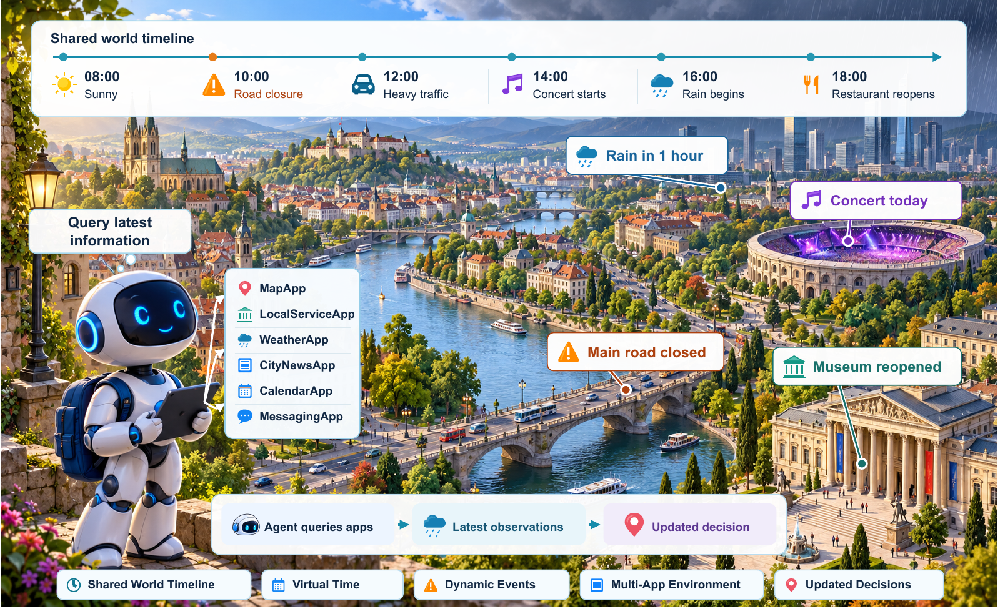

<div align="center">

# GeoWorld

**为地理智能体构建随时间演化的城市环境。**

[English](README.md) · 简体中文

[](https://arxiv.org/abs/2611.17267)
[](https://livegeoworld.github.io/)
[](https://github.com/LiveGeoWorld/LiveGeo-benchmark)
[](#快速开始)

[**快速开始**](#快速开始) · [**使用文档**](#使用文档) · [**引用**](#引用)

</div>

[](docs/assets/geoworld-github.pdf)

## 项目概览

**GeoWorld** 是一个地理模拟平台。你可以构建或加载一座真实城市，让智能体通过工具查询地点、路线和本地服务，并观察它在交通、天气、营业状态和城市事件沿同一条时间线变化时如何应对。

**LiveGeo** 是我们用 GeoWorld 构建的评测基准。它考察智能体能否做出有效的地理决策，并在世界变化后让决策继续有效；七类任务均在配对的静态与动态设置下运行。

| | |
| --- | --- |
| **世界** | 6 座真实城市 · 88 个区域 · 1,376 个兴趣点 · 107,372 条缓存路线 |
| **智能体接口** | 8 个 App · 31 个工具，所有返回结果都对应当前虚拟时间的世界状态 |
| **评测基准** | 1,237 个任务：1,088 个静态任务 + 149 个配对动态任务，覆盖 7 类任务 |

**从这里开始**

- [**试用 GeoWorld**](#快速开始) — 在 World Studio 中打开随附的示例城市，无需 API 密钥。
- [**使用 LiveGeo 评测**](#使用-livegeo-评测) — 用基准任务测试你的智能体。
- [**构建自己的基准**](#构建自己的基准) — 基于 GeoWorld 的城市、工具和事件回放编写任务生成器。

## 快速开始

使用 Python 3.10 或更高版本，在仓库根目录运行：

```bash
python -m pip install -e .
python -m vis.demo --port 8769
```

然后打开 <http://localhost:8769/>，查看示例地图、人物关系图和世界管理页面。

- 随附示例包含三个已记录的伦敦地点及其缓存路线和服务资料，以及三位已记录的参与者。
- **无需任何 API 凭据**。首次启动时，示例世界会安装到 `outputs/worlds/`；之后启动会直接复用，不会覆盖你的修改。浏览器会在线加载底图。
- **Tasks & Evaluation** 中附有已记录的任务示例，可用于试用工作台。

要根据地理数据源构建城市，请先配置外部服务，在 World Studio 中创建空世界，再选择城市或导入城市种子。详见[世界构建指南](docs/world_construction.md)。

## 使用 LiveGeo 评测

LiveGeo 覆盖七类任务，包含 **1,088 个静态任务和 149 个配对动态任务**。任务数据发布在 [LiveGeo-benchmark](https://github.com/LiveGeoWorld/LiveGeo-benchmark)。

| 层级 | 任务 | 智能体需要完成什么 |
| --- | --- | --- |
| 原子任务 | 地点定位（Grounding） | 根据图像或文字线索识别地点。 |
| 原子任务 | 地点发现（Discovery） | 找到满足位置、服务或偏好要求的地点。 |
| 原子任务 | 出行规划（Mobility Planning） | 判断行程是否可行，并在需要时给出路线。 |
| 复合任务 | 多主体协同（Multi-Entity） | 为出发地和日程各不相同的参与者找到共同方案。 |
| 复合任务 | 长程规划（Long-Horizon） | 安排一日或多日内相互衔接的一系列活动。 |
| 复合任务 | 安全感知（Safety-Aware） | 考虑影响目的地或沿途通行的风险。 |
| 复合任务 | 地域感知（Region-Aware） | 结合当地习惯和地域信息选择地点。 |

配对的动态任务与对应的静态任务从相同的用户请求和初始世界状态开始：

- **静态设置（Static）** — 与任务相关的条件保持不变。
- **任务专属动态（Task-Only Dynamics）** — 为该任务构造的事件随虚拟时间推进生效。
- **共享动态（Shared Dynamics）** — 其他城市事件也出现在同一条时间线上，智能体需要判断哪些变化会影响自己的计划。

在 **Tasks & Evaluation → Test Results** 中可以查看已记录的模型答案、评分结果和工具调用轨迹，无需模型凭据。运行自己的评测请见[评测指南](docs/evaluation.md)。

## 构建自己的基准

你可以在 GeoWorld 上编写自己的任务生成器。生成器决定构造哪些场景、怎样判断答案有效；GeoWorld 提供城市环境、供智能体查询的工具，以及用于重放变化的虚拟时钟。

1. **选择城市。** 复用已保存的城市快照，或在 World Studio 中构建一座城市。记录生成任务时使用的版本，保证任务始终对应同一批地点、路线和服务信息。
2. **生成请求和参考答案。** 从城市事实中选择场景并写出用户请求。保存任务要求和支持参考答案的证据，供评测使用。智能体通过用户请求和所需工具获取解题信息。
3. **安排动态事件。** 对动态任务，说明变化何时发生、影响什么，以及智能体可以从哪里获知。核验参考答案在变化前后都满足当时的要求。
4. **运行和评分。** 将任务与对应的城市快照、事件时间线一起加载，让智能体与环境交互，再按你为任务定义的规则评分。

> **示例：咖啡馆选择。** 找出在指定时间营业、且在用户步行时长限制内的咖啡馆。核验参考答案后加入一次临时闭店事件，再检查哪些备选地点仍然可行。用同一个请求分别运行有无该事件的版本，就能观察智能体能否发现变化并改选可行地点。LiveGeo 的构建流程就是构造和核验这类配对任务的完整参考。

## 数据与复现

| 数据 | 内容 |
| --- | --- |
| **GeoWorld 城市快照** | 模拟器使用的地理与服务数据。论文中的实例覆盖 6 座城市、88 个区域、1,376 个兴趣点和 107,372 条缓存路线记录。 |
| **LiveGeo 基准数据** | 任务请求、对应的城市版本、事件时间表和评测参考资料。 |
| **World Studio 示例** | 用于本地试用界面的小型已记录地图和人物文件。 |

复现实验时，请使用相同的代码与数据版本、城市快照、评测设置以及智能体和模型配置。[数据指南](data/README.md)说明了示例和本地世界产物的存放位置。

## 仓库结构

```text
GeoWorld/
├── world_module/   城市地图、人物、地域资料和世界版本管理
├── vis/            World Studio 网页界面和本地服务
├── task_module/    任务构建
├── app/            面向智能体的 App 与工具
├── test_runner/    环境运行与评测
├── shared/         共用配置、外部服务客户端和工具函数
├── seeds/          城市种子
├── examples/       World Studio、工作台和 Test Results 的已记录示例
└── docs/           使用指南
```

## 测试

```bash
python -m pip install -e ".[test]"
python -m pytest -q
```

单元测试使用临时数据和随附的配置示例，无需 API 凭据，也不会下载 Wikivoyage 来源包。

## 使用文档

| 指南 | 内容 |
| --- | --- |
| [世界构建](docs/world_construction.md) | 外部服务配置与城市登记 |
| [评测](docs/evaluation.md) | 运行评测与查看 Test Results |
| [Grounding 任务生成](docs/grounding.md) | 生成地点定位任务 |
| [任务审核](docs/task_review.md) | 在工作台中审核与编辑任务 |
| [项目架构](docs/architecture.md) | 各模块如何协同工作 |
| [示例数据](docs/demo_data.md) | 随附示例包含哪些内容 |
| [数据组织](data/README.md) | 示例和本地世界产物的存放位置 |

## 引用

如果在研究中使用 GeoWorld 或 LiveGeo，请引用：

```bibtex
@misc{zhou2026livegeobenchmarkinggeographicagents,
  title={LiveGeo: Benchmarking Geographic Agents in Continuously Evolving Worlds},
  author={Pengcheng Zhou and Xuanyu Liu and Yanchen Yin and Tianjie Ju and
          Bobo Li and Shengqiong Wu and Hao Fei and Mong-Li Lee and Wynne Hsu},
  year={2026},
  eprint={2611.17267},
  archivePrefix={arXiv},
  primaryClass={cs.AI},
  url={https://arxiv.org/abs/2611.17267},
}
```

<!-- 许可证：补充 LICENSE 文件后，在这里链接代码许可证、数据许可和第三方资产说明。 -->
